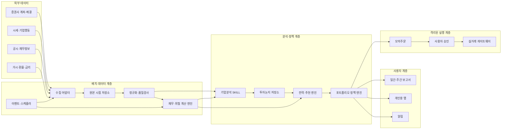

# 02. 전체 시스템 아키텍처

## 1. 아키텍처 결론

시스템은 다음 순서로 구축한다.

1. **배치 계층**: 신뢰할 수 있는 데이터와 반복 가능한 계산
2. **SKILL 계층**: 근거 기반의 공시 해석과 투자논지 추적
3. **앱 계층**: 결과 검토, 피드백, 승인에 최적화된 개인 UI
4. **실행 계층**: 충분한 검증 이후 추가하는 격리된 주문 기능

앱과 SKILL은 동일한 데이터·정책·계산 서비스를 사용한다. 서로 다른 계산 로직을 중복 구현하지 않는다.

## 2. 논리 구조

## 3. 핵심 컴포넌트

### 3.1 수집 어댑터

외부 API의 형식을 내부 표준 모델로 변환한다.

- 계좌·잔고·체결
- 일별 및 필요 시 실시간 시세
- 분할, 배당, 합병, 상장폐지 등 기업행동
- DART 공시 원문과 재무제표
- 환율, 금리, 물가 등 거시 데이터

각 시장과 공급자는 별도 어댑터로 격리한다.

### 3.2 원본 시점 저장소

외부 응답을 가공 전에 저장한다.

- 수집시각
- 데이터가 시장에 공개된 시각
- 공급자와 요청 파라미터
- 원문 해시
- 정정·재수집 관계

이 저장소는 백테스트와 감사의 기준이다.

### 3.3 정규화·품질 계층

- 종목 식별자 매핑
- 통화·단위·회계기간 표준화
- 중복 및 누락 검사
- 재무제표 정정 감지
- 거래일 달력 적용
- 기업행동 반영

### 3.4 결정론적 계산 엔진

- 수익률과 비용
- 재무비율과 성장률
- 밸류에이션
- 포트폴리오 노출과 위험
- 전략 신호
- 백테스트

동일 입력과 코드 버전은 동일 결과를 만들어야 한다.

### 3.5 AI 분석 계층

- 공시의 중요 변화 추출
- 경영진 주장과 실제 결과 비교
- 강세·기준·약세 시나리오
- 투자논지와 무효화 조건 작성 지원
- 반대 논거 및 누락된 정보 탐색

AI는 원본 데이터나 계산 결과를 수정하지 않는다.

### 3.6 정책 엔진

전략 신호를 사용자에게 보여주기 전에 다음을 적용한다.

- 자산배분 정책
- 종목·섹터·통화 한도
- 데이터 신선도
- 모델 및 전략 승격 상태
- 예상 비용과 세금
- 계좌 제약

### 3.7 전달 계층

- 이벤트 알림
- 일간·주간·월간 보고서
- 앱 화면
- 사용자 피드백과 승인

### 3.8 실행 계층

분석 시스템과 비밀키를 분리한다.

- 초기: 모의주문만
- 중기: 주문 초안 생성과 사용자 승인
- 장기: 명시적으로 허용된 주문만 제한적 자동화
- 공통: 한도, 중복 주문 방지, 거래시간 검사, 킬 스위치

## 4. 주요 처리 흐름

### 신규 공시

1. 공시 목록에서 새 항목을 감지한다.
2. 원문을 저장하고 중요도를 규칙 기반으로 1차 분류한다.
3. 관련 재무·투자논지 컨텍스트를 구성한다.
4. SKILL이 변화, 영향, 반증 가능성을 분석한다.
5. 정책 엔진이 보유 종목과 위험을 연결한다.
6. 중요도가 임계값 이상인 경우에만 알림을 만든다.

### 정기 포트폴리오 검토

1. 최신 잔고와 체결을 동기화한다.
2. 수익률, 노출, 집중도, 비용을 계산한다.
3. 목표 자산배분과 위험 한도를 비교한다.
4. 투자논지 상태와 다음 이벤트를 결합한다.
5. `NO_ACTION`, `REVIEW`, `REBALANCE_PROPOSAL` 중 하나를 생성한다.

## 5. 신뢰 경계

| 영역 | 읽기 | 쓰기 | 주문 가능 |
|---|---|---|---|
| 수집기 | 외부 데이터 | 원본 저장소 | 아니오 |
| 계산 엔진 | 정규화 데이터 | 계산 결과 | 아니오 |
| AI SKILL | 승인된 컨텍스트 | 분석 결과 초안 | 아니오 |
| 앱 | 사용자 데이터 | 피드백·승인 | 직접 불가 |
| 실행 게이트웨이 | 승인 주문 | 주문·체결 로그 | 제한적으로 가능 |

### 금지

- AI 프로세스에 증권사 App Secret 또는 주문 토큰 전달
- 앱 클라이언트에 장기 비밀키 저장
- 원본 데이터의 사후 덮어쓰기
- 승인 기록 없는 실거래

## 6. 배포 구조

### 제안: 개인용 단일 배포에서 시작

- 배치 워커와 API 서버
- 관계형 메타데이터 저장소
- 원본 파일 및 분석 산출물 저장소
- 개인용 웹앱
- 비밀관리와 주문 게이트웨이

초기에는 모듈러 모놀리스로 시작하고, 주문 계층만 프로세스와 자격증명을 분리한다. 마이크로서비스는 독립 확장이나 보안 경계가 실제로 필요해질 때 도입한다.

## 7. 기술 후보

기술은 아직 확정하지 않는다.

| 영역 | 제안 후보 | 선택 기준 |
|---|---|---|
| 데이터·분석 | Python, SQL | 금융·데이터 생태계, 재현성 |
| API | FastAPI 계열 | 타입 계약과 비동기 작업 연동 |
| 운영 DB | PostgreSQL | 트랜잭션, 관계, JSON 지원 |
| 원본·분석 파일 | Parquet + 객체 저장소 | 시점 데이터와 대량 분석 |
| 작업 오케스트레이션 | 경량 스케줄러 또는 워크플로 엔진 | 재시도, 백필, 관찰성 |
| 앱 | 웹 기반 PWA | 개인 사용과 빠른 반복 |
| 모델 연동 | 구조화 출력과 도구 호출 지원 LLM | 출처 연결, 스키마 준수 |

## 8. 비기능 요구사항

- 재현성: 데이터·코드·프롬프트·모델 버전 기록
- 멱등성: 동일 작업 재실행 시 중복 산출물 방지
- 관찰성: 작업 상태, 데이터 신선도, 오류, 비용 추적
- 감사성: 추천에서 원문까지 역추적
- 보안성: 최소 권한과 비밀 분리
- 확장성: 한국 우선, 시장 어댑터로 미국 확장
- 비용통제: 변경된 문서만 AI 분석하고 결과 캐시

## 9. 검토가 필요한 결정

- 로컬 전용과 개인 클라우드 중 배포 방식
- 관계형 DB와 파일 저장소의 구체적 제품
- 워크플로 오케스트레이터 도입 시점
- 실시간 시세의 필요성
- 한국 시장 우선 범위
- 앱과 배치 보고서의 인증 방식
