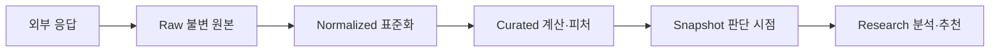

# 03. 데이터 아키텍처

## 1. 목표

데이터 계층의 목표는 최신 값 하나를 보여주는 것이 아니라, **특정 판단 시점에 어떤 정보가 실제로 사용 가능했는지 재현**하는 것이다.

## 2. 데이터 원칙

### 확정

- 원본 응답은 수정하지 않고 새 버전으로 저장한다.
- `관측 대상 시점`, `시장 공개 시점`, `시스템 수집 시점`을 구분한다.
- 가격과 재무정보의 통화·단위·기업행동 조정 여부를 명시한다.
- 숫자는 가능한 한 원문 필드와 계산식을 추적할 수 있어야 한다.
- 정정공시와 수정 재무제표는 이전 버전을 덮어쓰지 않는다.
- 데이터 신선도가 정책 기준보다 낮으면 추천을 생성하지 않는다.

## 3. 데이터 소스

| 영역 | 1차 소스 제안 | 용도 | 주의점 |
|---|---|---|---|
| 계좌·체결 | 사용 증권사 API 또는 CSV | 잔고, 평균단가, 현금흐름 | 계좌 기준 진실 |
| 공시 | OpenDART | 공시 원문, 재무, 지분, 주요사항 | 정정과 연결공시 |
| 시장 통계 | KRX Open API | 종목·지수·시장 통계 | 사용·재배포 정책 |
| 주문·시세 | 증권사 Open API | 조회, 모의·실거래 | 호출 한도와 토큰 |
| 거시 | 한국은행·공식 통계 | 금리, 물가, 환율 맥락 | 발표시점과 개정 |
| 미국 확장 | SEC EDGAR·공식 거시 API | 공시와 거시 | 시장별 별도 스키마 |
| 뉴스 | 검토 후 결정 | 사건 탐지 보조 | 원문 라이선스·신뢰도 |
| 컨센서스 | 미결정 | 시장 기대 비교 | 대부분 라이선스 비용 발생 |

뉴스, 블로그, 커뮤니티 데이터는 `secondary_signal`로 표시하며 핵심 사실의 단독 근거로 사용할 수 없다.

## 4. 데이터 영역



### Raw

- API 원문, 공시 파일, 계좌 CSV
- 요청·응답 메타데이터
- 해시, 수집시각, 공급자 버전

### Normalized

- 표준 종목 ID
- 통화, 단위, 날짜, 회계기간
- 공급자별 필드를 내부 표준 필드로 변환

### Curated

- 재무비율
- 수익률·변동성
- 기업행동 조정 가격
- 포트폴리오 노출
- 전략별 피처

### Snapshot

특정 의사결정 또는 백테스트 시점에 사용 가능한 데이터 세트의 참조 목록이다. 분석 결과는 반드시 `snapshot_id`를 가진다.

### Research

- 투자논지
- 시나리오
- 추천
- 사용자 피드백
- 실험 및 백테스트 결과

## 5. 핵심 식별자

### 내부 ID

- `instrument_id`: 주식, ETF, 현금성 자산 등 거래수단
- `company_id`: 법인
- `listing_id`: 거래소 상장 단위
- `account_id`: 계좌
- `filing_id`: 공시 원문 버전
- `snapshot_id`: 판단 시점 데이터 묶음
- `thesis_id`: 투자논지 버전 체인
- `strategy_id`: 전략과 버전
- `recommendation_id`: 추천 기록

종목코드는 변경되거나 시장별로 중복될 수 있으므로 영구 식별자로 사용하지 않는다.

## 6. 시간 모델

모든 중요한 레코드는 가능한 범위에서 다음 시간을 갖는다.

```yaml
time_model:
  effective_at: "경제적 사건 또는 관측 대상 시점"
  published_at: "시장에 공개된 시점"
  ingested_at: "시스템이 수집한 시점"
  valid_from: "내부 데이터 버전이 유효해진 시점"
  valid_to: "다음 버전으로 대체된 시점 또는 null"
```

백테스트는 `published_at <= decision_time`인 정보만 사용할 수 있다.

## 7. 재무 데이터 모델

다음 요소를 함께 보존한다.

- 연결·별도 재무제표 구분
- 연간·반기·분기 보고기간
- 누적값과 단일 분기값 구분
- 원화·외화와 표시 단위
- 회계기준
- 계정과목의 원문명과 표준 매핑
- 정정 여부
- 감사의견

단일 분기 손익을 누적 공시에서 계산한 경우 원본 값이 아닌 `derived`로 표시하고 계산식을 기록한다.

## 8. 가격과 기업행동

- 원시 종가와 조정 종가를 별도 보관한다.
- 배당, 분할, 병합, 유상증자, 권리락, 합병, 상장폐지를 모델링한다.
- 백테스트의 총수익은 현금배당과 기업행동을 반영한다.
- 당시 실제 투자 가능했던 종목 집합을 보존한다.
- 거래정지와 유동성 부족을 주문 가능성에 반영한다.

## 9. 데이터 품질 검사

### 자동 검사

- 필수 필드 누락
- 중복 레코드
- 시간 역전
- 비정상 단위 또는 통화
- 전일 대비 비정상 급변
- 자산 = 부채 + 자본 불일치
- 현금흐름 합계 불일치
- 시가총액과 주식 수의 불일치
- 공시 정정 미연결
- 거래일 누락

### 품질 상태

```text
VALID → SUSPECT → QUARANTINED → CORRECTED
```

`SUSPECT` 이상인 데이터가 핵심 판단에 사용되면 추천을 보류한다.

## 10. 데이터 신선도

각 데이터 세트에 다음을 정의한다.

- 기대 갱신 주기
- 최대 허용 지연
- 마지막 성공 수집시각
- 공급자 장애 상태
- 대체 데이터 사용 여부

앱과 보고서는 값뿐 아니라 `as_of`와 신선도 경고를 보여준다.

## 11. 보존과 삭제

- 원본 공시와 의사결정 스냅샷은 장기 보존한다.
- 민감한 계좌 원본은 암호화하고 보존기간을 별도로 설정한다.
- 로그에 계좌번호, 토큰, 비밀키를 기록하지 않는다.
- 사용자 피드백과 승인 이력은 감사 로그로 보존한다.

## 12. 데이터 라이선스

- 개인 내부 사용과 외부 재배포를 구분한다.
- 공급자별 저장·표시·재배포·파생데이터 조건을 기록한다.
- 외부 서비스화 전 모든 데이터 소스의 라이선스를 재검토한다.
- 라이선스가 불명확한 데이터를 모델 학습용으로 재사용하지 않는다.

## 13. 검토가 필요한 결정

- 1차 증권사와 계좌 수집 방식
- 실시간 또는 일봉 중심
- 뉴스와 컨센서스 데이터 구매 여부
- 원본 저장소의 위치와 암호화 방식
- 계좌 데이터 보존기간
- 한국 기업 계정과목 표준화 범위
