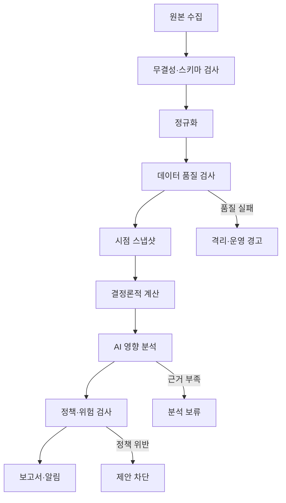

# 04. 배치 계층 설계

## 1. 역할

배치 계층은 시스템의 기반이다. 외부 데이터를 반복 가능하게 수집하고, 품질을 검사하며, 계산과 분석을 실행하고, 중요한 변화만 사용자 계층에 전달한다.

## 2. 설계 원칙

### 확정

- 모든 작업은 멱등성을 가진다.
- 작업 입력과 산출물에 버전을 기록한다.
- 실패한 작업은 안전하게 재시도할 수 있다.
- 과거 기간을 지정해 백필할 수 있다.
- 원본 수집 실패와 분석 실패를 구분한다.
- 일부 데이터가 오래됐을 때 조용히 최신인 것처럼 처리하지 않는다.
- 장중 초단타가 아니라 일·주·분기 단위 의사결정을 우선한다.

## 3. 작업 목록

| 작업 | 트리거 | 주요 입력 | 산출물 |
|---|---|---|---|
| 계좌 동기화 | 수동·정기 | 증권사 또는 CSV | 잔고·체결·현금흐름 |
| 종목 마스터 동기화 | 일간 | 거래소·증권사 | 상장·종목 식별자 |
| 시세 수집 | 장 마감 후 | 시장 데이터 | 일별 가격·거래량 |
| 기업행동 수집 | 일간 | 거래소·공시 | 배당·분할·합병 등 |
| 공시 스캔 | 주기·이벤트 | OpenDART | 신규·정정 공시 |
| 재무 정규화 | 공시 도착 | 재무 원문 | 표준 재무 레코드 |
| 피처 계산 | 데이터 갱신 후 | 정규화 데이터 | 재무·가격·위험 지표 |
| 논지 영향 분석 | 중요 이벤트 | 스냅샷·논지 | 영향 분석 초안 |
| 정책 평가 | 이벤트·일간 | 포트폴리오·추천 | 경고·보류·제안 |
| 일간 요약 | 장 마감 후 | 이벤트·정책 결과 | 중요한 변화 요약 |
| 주간 검토 | 주말 | 전체 포트폴리오 | 위험·논지 보고서 |
| 월간 검토 | 월말 | 목표 배분·비용 | 리밸런싱 초안 |
| 분기 검토 | 실적 공시 후 | 재무·가이던스 | 논지 검증 보고서 |

구체적인 실행 시각과 주기는 데이터 공급자의 호출 한도와 사용자 생활 패턴을 확인한 후 확정한다.

## 4. 작업 그래프



## 5. 작업 공통 계약

모든 작업 실행은 다음 메타데이터를 남긴다.

```yaml
job_run:
  job_name: string
  job_version: string
  run_id: uuid
  scheduled_for: datetime
  started_at: datetime
  finished_at: datetime
  input_snapshot_ids: []
  output_artifact_ids: []
  status: SUCCESS | PARTIAL | FAILED | BLOCKED
  retry_count: integer
  error_class: string | null
  metrics: {}
```

## 6. 멱등성과 중복 방지

- 외부 원문은 공급자 ID, 요청 범위, 내용 해시로 식별한다.
- 동일 공시 버전을 여러 번 받아도 하나의 원본으로 연결한다.
- 보고서는 `report_type + portfolio_id + as_of + version`으로 식별한다.
- 알림은 동일 사건과 동일 영향에 대해 중복 발송하지 않는다.
- 주문 초안은 사용자 승인 전까지 실제 주문으로 승격되지 않는다.

## 7. 실패 처리

### 재시도 가능

- 일시적 네트워크 오류
- 호출 한도 초과
- 공급자 5xx 오류
- 일시적 모델 응답 오류

### 자동 재시도 금지 또는 제한

- 인증 실패
- 스키마 변경
- 데이터 품질 위반
- 주문 정책 위반
- 동일 주문 여부가 불분명한 타임아웃

실패 시 오래된 데이터를 최신 결과로 가장하지 않고 `STALE` 또는 `BLOCKED` 상태를 노출한다.

## 8. 보고서 정책

### 일간

- 신규 중요 공시
- 논지 무효화 가능성
- 포트폴리오 한도 접근 또는 초과
- 데이터·운영 이상
- 행동이 필요하지 않으면 `NO_ACTION`

### 주간

- 전체 성과와 기준지수 비교
- 종목·섹터·국가·통화 집중도
- 보유 논지 상태
- 다음 주 예정 이벤트
- 미해결 연구 질문

### 월간

- 목표 배분 이탈
- 비용과 회전율
- 리밸런싱 후보와 예상 영향
- 전략별 성과 기여

### 분기

- 실적 변화
- 경영진의 과거 가이던스 적중 여부
- 현금흐름과 재무건전성
- 밸류에이션과 시나리오 갱신
- 투자논지 유지·수정·폐기

## 9. 관찰성

대시보드 또는 운영 보고서에서 다음을 본다.

- 최근 작업 성공 여부
- 데이터 소스별 마지막 갱신
- 수집 레코드 수와 평소 대비 변화
- 데이터 품질 경고
- AI 호출 수, 비용, 지연, 스키마 실패율
- 생성·억제된 알림 수
- 작업별 재시도와 실패 원인

## 10. 비용 관리

- 변경되지 않은 공시와 분석 결과를 재사용한다.
- 먼저 규칙 기반으로 중요도를 분류한 후 AI를 호출한다.
- 전체 원문 대신 관련 구간과 구조화된 계산 결과를 컨텍스트로 제공한다.
- 저비용 모델의 분류 결과가 임계값을 넘을 때만 심층 분석을 수행한다.
- 토큰·데이터 호출·저장 비용을 종목과 작업별로 측정한다.

## 11. 검토가 필요한 결정

- 장 마감 기준 일간 작업 시각
- 공시 스캔 주기
- 알림 채널
- 사용할 작업 오케스트레이터
- 부분 실패 시 보고서 생성 여부
- 휴장일과 해외시장 시차 처리
