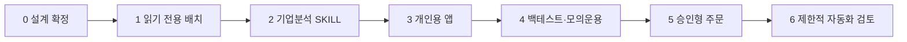

# 10. 구현 로드맵

## 1. 원칙

- 단계는 기능 수가 아니라 **신뢰 수준**에 따라 승격한다.
- 다음 단계의 UI가 이전 단계의 데이터 결함을 숨기지 않게 한다.
- 실거래는 마지막 단계다.
- 각 단계는 독립적으로 쓸 수 있는 결과를 만든다.
- 일정은 데이터 접근성과 사용자 검토 속도를 확인한 뒤 정한다.

## 2. 단계 개요



### 현재 구현 스냅샷

전체 단계 1이 끝난 것은 아니지만, 선행 안전장치인 구조화 매매 점검기,
세 분모 비중 계산, IPS·분석 계약 검증, DART/EDGAR 분기 복원 회귀 테스트는
구현됐다. 단계 0의 IPS가 아직 `DRAFT`이므로 실사용 거래 판정은
`RESEARCH_REQUIRED`에서 멈춘다.

## 3. 단계 0: 설계와 투자정책

### 목표

무엇을 최적화할지, 어떤 위험을 허용할지, 어떤 시장부터 시작할지 확정한다.

### 산출물

- 제품 헌장
- 개인 투자정책
- 대상 시장과 증권사 결정
- 데이터 소스와 라이선스 조사
- 기준지수
- 초기 전략 가설
- 보안·배포 방식

### 완료 조건

- `docs/01-investment-policy.md`의 핵심 `미결정` 항목 확정
- 1차 시장·계좌·데이터 공급자 확정
- 코어와 액티브 실험의 자금 경계 확정
- 실거래 제외 범위 동의

## 4. 단계 1: 읽기 전용 배치 MVP

### 목표

계좌와 공식 데이터를 재현 가능하게 수집하고, AI 없이도 정확한 포트폴리오 상태를 생성한다.

### 구현 범위

- 종목 마스터
- 계좌 CSV 가져오기 또는 조회 API
- 잔고·체결·현금흐름 정규화
- 일별 시세와 기업행동
- DART 공시 목록과 원문 저장
- 핵심 재무제표 정규화
- 포트폴리오 수익률과 집중도
- 일간 데이터 상태 보고서

### 완료 조건

- 동일 입력 재실행 시 중복 없음
- 계좌의 증권사 표시 값과 내부 값의 허용 오차 내 일치
- 공시 원문과 정규화 데이터 역추적 가능
- 데이터 신선도와 실패 상태 확인 가능
- 비밀정보가 로그에 남지 않음

### 제외

- 자연어 종목 추천
- 자동 투자논지
- 웹앱
- 주문

## 5. 단계 2: 기업분석 SKILL

### 목표

신규 공시와 재무 변화가 기존 투자논지에 미치는 영향을 근거와 함께 설명한다.

### 구현 범위

- 회사 컨텍스트 빌더
- 재무 변화 설명
- 공시 중요도 분류
- 기업 투자논지 초안
- 강세·기준·약세 시나리오
- 경영진 가이던스 추적
- 반론·근거 검증
- 구조화 출력과 출처 링크

### 완료 조건

- 고정 평가 세트에서 숫자 인용 오류가 허용 기준 이하
- 핵심 주장 대부분에 원문 또는 계산 근거 연결
- 사실·계산·추론·가설 구분
- 근거 부족 시 `UNKNOWN` 또는 `RESEARCH_REQUIRED`
- 사용자의 수정 내용을 버전으로 보존

### 제외

- 직접 매수·매도 주문
- 사용자 정책 자동 변경
- 자유형 모델 출력을 공식 숫자로 저장

## 6. 단계 3: 개인용 앱

### 목표

배치와 SKILL 결과를 편리하게 검토하고 수정·승인한다.

### 구현 범위

- 홈과 중요 이벤트
- 포트폴리오 배분·성과·위험
- 기업 상세와 투자논지
- 공시·근거 탐색
- 사용자 수정과 승인
- 운영 상태와 데이터 신선도
- 인증과 감사 로그

### 완료 조건

- 앱의 모든 핵심 숫자가 서버 계산 결과와 일치
- 추천에서 원문까지 이동 가능
- 모바일과 데스크톱에서 핵심 검토 가능
- 승인과 정책 변경 이력 추적 가능
- 데이터 지연·오류가 명확히 표시됨

### 제외

- 공개 회원가입
- 소셜 기능
- 실거래 주문

## 7. 단계 4: 전략 연구와 모의운용

### 목표

복잡한 전략이 단순 기준 전략보다 실제로 가치가 있는지 검증한다.

### 구현 범위

- 백테스트 엔진
- 당시 투자 가능 종목 집합
- 비용·세금·기업행동 모델
- 전략 실험 레지스트리
- 워크포워드와 스트레스 테스트
- 실시간 미래 방향 모의 포트폴리오
- 추천 확률과 논지 경보 평가

### 완료 조건

- 미래정보·생존편향 통제 검증
- 기준지수와 단순 전략 비교
- 모든 실험 재현 가능
- 비용 후 결과 확인
- 미사용 기간과 모의운용 승격 기준 충족
- 특정 기간·종목 의존성 검토

## 8. 단계 5: 승인형 주문

### 목표

검증된 행동 후보를 별도 위험검사와 명시적 사용자 승인 후 실행한다.

### 구현 범위

- 모의·실거래 자격증명 분리
- 주문 초안
- 사전 위험검사
- 2단계 사용자 승인
- 중복 주문 방지
- 체결 동기화
- 킬 스위치
- 주문·체결 감사 로그

### 완료 조건

- 모든 주문 상태 전이 테스트
- 미확인 타임아웃에서 중복 주문 없음
- 한도 초과 주문 차단
- 킬 스위치와 복구 절차 훈련
- 소규모 자금과 제한된 주문 유형으로 운영 검증

## 9. 단계 6: 제한적 자동화 검토

완전 자동화는 기본 목표가 아니다. 다음을 모두 만족할 때만 일부 자동화를 검토한다.

- 충분한 승인형 실거래 운영 기록
- 반복적인 수동 승인 패턴이 명확함
- 자동화 대상이 단순하고 결정론적임
- 엄격한 금액·빈도·자산 한도
- 언제든 자동 중단 가능
- 법률·증권사 약관·운영 위험 검토 완료

예상 가능한 자동화 후보는 정기 적립 또는 정책 기반 리밸런싱이며, AI의 자유형 종목 선택은 우선 대상이 아니다.

## 10. 제안 저장소 구조

구현 단계에서 다음과 같이 시작할 수 있다.

```text
money/
├── README.md
├── docs/
├── apps/
│   ├── api/
│   ├── worker/
│   └── web/
├── packages/
│   ├── domain/
│   ├── data-connectors/
│   ├── finance-engine/
│   ├── policy-engine/
│   ├── research-skills/
│   └── execution-gateway/
├── strategies/
├── migrations/
├── tests/
│   ├── fixtures/
│   ├── golden/
│   └── integration/
└── ops/
```

실제 언어와 프레임워크가 확정되면 언어 생태계에 맞게 조정한다.

## 11. 첫 번째 개발 백로그

1. 사용자 투자정책 입력값 확정 및 `knowledge/portfolio/ips.json` 승인
2. 증권사와 계좌 데이터 방식 조사
3. 내부 종목·회사 식별자 정의
4. 원본 데이터 저장 규칙 구현
5. DART 종목·공시 수집
6. 계좌 CSV 가져오기
7. 포트폴리오 스냅샷 계산 (총자산·주식 슬리브·위험자산 분모 포함)
8. 데이터 품질 검사
9. 일간 읽기 전용 보고서
10. 고정 테스트 데이터와 회귀 테스트

## 12. 검토가 필요한 결정

- 단계 1에서 계좌 API와 CSV 중 무엇을 우선할지
- 1차 시장과 기준지수
- 기술 스택
- 로컬·클라우드 배포
- 초기 기업 분석 대상 종목 수
- 단계별 정량 완료 기준
