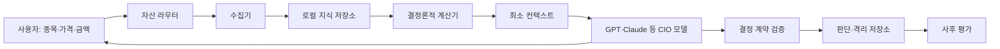

# 아키텍처

## 한 문장 구조

사용자가 종목·가격·금액을 좁히면 로컬 PC가 필요한 사실과 계산만 모아 작은
컨텍스트를 만들고, 교체 가능한 모델이 CIO 판단을 내리며, PC가 그 판단의 형식과
산술을 검증해 기억으로 보존한다.

## 권한 경계

### 사용자

- 분석할 자산과 검토 가격, 실제로 사용할 수 있는 금액을 정한다.
- 모델의 판단을 검토하고 실제 주문 여부를 결정한다.
- 정책과 자산 registry의 최종 소유자다.

### 로컬 PC

- 공식·구조화 데이터를 수집하고 기준시점과 출처를 기록한다.
- 수익률, 변동성, 포트폴리오 영향, 재무 항등식 등 결정론적 계산을 수행한다.
- 누락·신선도·참조·스키마·확률 합·가격 순서 같은 기계 검증을 수행한다.
- 컨텍스트, 모델 판단, 실패 출력, 사후 평가를 로컬에 보존한다.
- 투자 매력도나 최종 매수·매도 판단을 대신하지 않는다.

### CIO 모델

- 자산과 산업에 맞는 방법론을 선택한다.
- 로컬 컨텍스트로 부족한 사업·산업·규제·경쟁 정보를 직접 조사한다.
- 가장 강한 반대 논지를 만든 뒤 승리 확률과 가격 계획을 포함한 verdict를 낸다.
- 원본·계산 결과를 수정하거나 주문을 실행하지 않는다.

관행적인 방법이나 가정을 쓰는 것도 모델의 선택에 포함한다. 프로그램은 선택된
PER·DCF 등의 계산을 재사용하며, 관행에서 가져온 값은 모델이 이유를 남기고 바꿀 수
있어야 한다. 관행의 채택과 자동 투자 판정을 구분하는 기준은
[가정 검토](assumptions.md#관행을-사용하는-법)에 있다.

## 주요 컴포넌트

| 위치 | 역할 |
|---|---|
| `config/assets.json` | KR/US, 주식/ETF, 벤치마크, 분석 렌즈와 가치평가 후보를 라우팅 |
| `collectors/` | DART, SEC EDGAR, 가격, 한국 이벤트·수급·재고 등 외부 데이터 수집 |
| `collectors/web.py` | 모델이 조사한 웹 원문을 정제 없이 내용 주소로 보존 |
| `cio/documents.py` | 보존한 원문을 색인하고 물어본 자리만 잘라 돌려줌 |
| `cio/requests.py` | 모델의 수집 요청을 미해결/해결로 추적하고 다음 컨텍스트에 환류 |
| `calculators/` | 재무 계약, 시장 국면, 포트폴리오, 비교·밸류에이션 계산 |
| `collectors/kr_etf_holdings.py`, `collectors/etf_constituents.py` | 운용사 원문의 ETF 구성종목과, 종목별 가격·배수·환율 |
| `calculators/etf_lookthrough.py` | ETF 구성종목의 가중 배수와 종목·환율 수익률 분해 |
| `calculators/fx_periods.py` | 달러/원 일봉을 결산 분기의 평균·기말로 접는 산술. 실적 영향은 추정하지 않음 |
| `collectors/krx.py` | 한국 종목·지수 시계열의 빈 거래일을 거래소 원문으로 메움 |
| `calculators/assumptions.py` | 모델이 정한 EPS 배수·DCF 가정, 대체 계산과 수익률 경계값의 산술 |
| `cio/assumptions.py` | 가정과 근거 파일을 context에 결속해 보존하고 모델 응답을 검증 |
| `cio/refresh.py` | 자산에 필요한 작업만 계획하고 신선도를 검사·갱신 |
| `cio/context.py` | 입력 가격·금액과 로컬 산출물을 작은 `cio-context/1.0.0` 패킷으로 조립 |
| `prompts/cio-system.md` | 공급자 중립 CIO 역할과 필수 질문 |
| `schemas/cio-decision.schema.json` | 모든 모델이 따라야 하는 공통 출력 계약 |
| `cio/decision.py` | 모델 출력의 참조·산술·가격 관계를 검증하고 지문 ID 생성 |
| `cio/memory.py` | 유효 판단, 실패 출력, 사후 평가를 분리해 보존 |

## 한 번의 판단 흐름

1. `python -m cio refresh <asset_id>`로 필요한 작업과 신선도를 확인한다.
2. `--run`으로 오래됐거나 없는 필수 데이터를 갱신한다.
3. `python -m cio prepare`가 가격·금액을 검증하고 컨텍스트를 저장한다.
4. 모델은 컨텍스트와 공통 프롬프트를 읽고, 필요하면 외부 조사를 추가한다.
5. 모델이 가정 spec을 만들고 `cio assumptions`가 대체 가정·수익률 경계값을
   계산한다. 모델은 결과를 해석해 공급자와 무관한 decision JSON을 출력한다.
6. 필요하면 `python -m cio validate`로 쓰기 없는 사전검사를 한다.
7. 공식 시도는 `python -m cio record`가 직접 재검증하고, 유효 판단 또는 실패
   원문을 각각 저장한다.
8. `python -m cio score`가 이후 가격으로 예측과 가격 트리거를 평가한다.

## Validation과 verdict

두 상태는 목적과 권위가 다르다.

| 필드 | 생산자 | 답하는 질문 |
|---|---|---|
| `context.validation` | PC | 필수 데이터와 입력이 현재 분석 가능한 상태인가 |
| `decision.verdict` | 모델 | 이 가격과 금액에서 어떤 투자 행동이 최선인가 |

`validation: PASS`는 매수 허가가 아니며 `BLOCKED`는 투자 매력도 평가가 아니다.
`BLOCKED`이면 먼저 갱신·조사하거나, 끝내 결론을 지탱할 수 없을 때 모델이
`INSUFFICIENT`를 반환한다.

## 모델 교체

컨텍스트와 decision schema는 공급자 중립이다. 모델 어댑터는 다음만 담당하면 된다.

1. 같은 컨텍스트와 `prompts/cio-system.md`를 전달한다.
2. 자유 문장이 아니라 decision JSON 하나를 받는다.
3. `model.provider`, `model.name`, `model.version`, `model.prompt_version`을 기록한다.

모델 제공자의 대화 기억은 공식 상태가 아니다. 공식 기억은 로컬의 context,
assessment, evaluation과 내용 주소형 evidence 파일이다.

## 의도적으로 없는 것

- 자동 종목 발굴
- 증권사 비밀키와 주문 실행
- 모델별로 갈라진 계산·데이터 계약
- 웹앱을 전제로 한 별도 상태
- 전체 원문·전체 과거 기록을 매번 모델에 넣는 방식
- 인기순 뉴스의 자동 수집 — 인기 기사는 가격을 따라다니는 2차 출처라, 이미
  가격에서 읽은 정보를 두 번 세게 만든다. 수집하는 것은 공시·발행인 원문 같은
  1차 출처이며, 그 밖의 조사는 모델이 하고 `cio snapshot`으로 보존한다
- 수집 단계의 본문 정제 — 광고·마크업 제거는 페이지가 바뀔 때마다 깨지고
  유지보수를 사람에게 떠넘긴다. 받은 바이트를 그대로 두고 해석은 모델이 한다
- 토픽별 수집기 — 메모리 판가, 스마트폰 출하량, 파운드리 수주를 각각 수집기로
  만들면 끝이 없고 다음에 무엇이 중요해질지 미리 알 수도 없다. 대신 원문을
  통째로 보존하고 검색으로 꺼낸다. 검색은 토픽에 종속되지 않으므로 새 이슈가
  생겨도 새로 만들 것이 없다

현재 구조는 한 종목의 구매 판단과 그 판단의 누적 평가에 집중한다.
