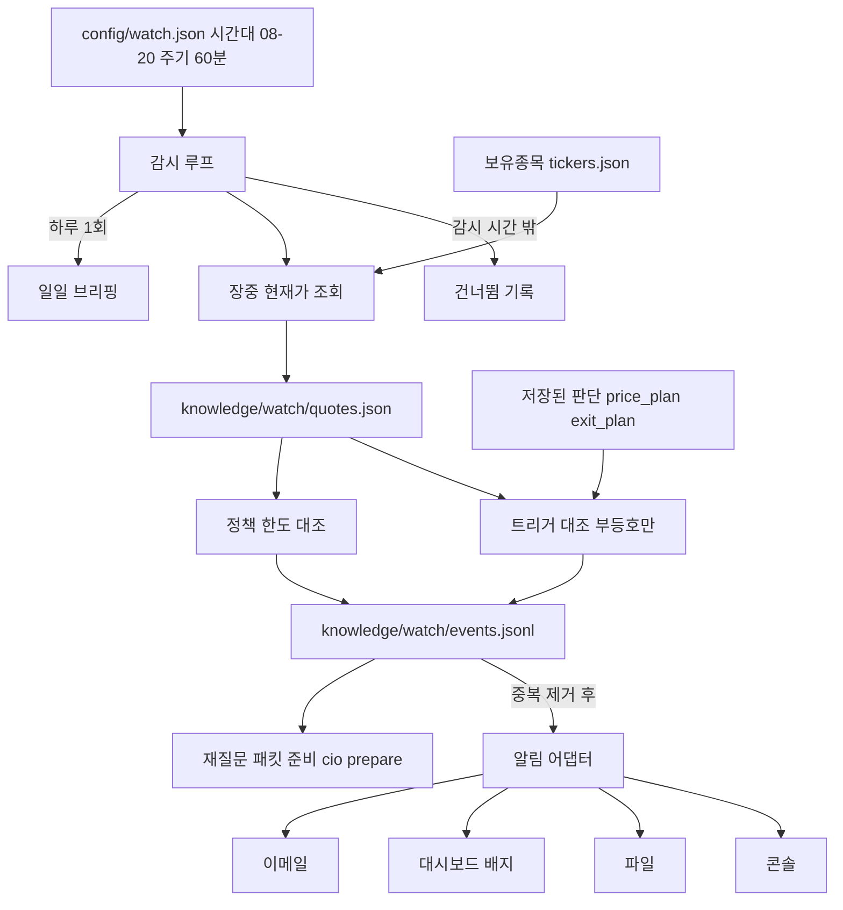

# 보유 종목 감시 배치 설계

> **상태: 설계 검토 중 — 미구현.** 이 문서의 어떤 항목도 아직 코드에 없다.
> 구현 단위로 쪼갠 작업 계획은 저장소 루트의 [`watch-batch-plan.md`](../watch-batch-plan.md)에 있다.

## 목적

보유 종목의 현재가를 주기적으로 확인해, **모델이 이미 저장한 판단의 가격 문턱과
사용자의 정책 한도에 닿았을 때** 사용자에게 알린다. 알림이 켜진 종목은 재질문
패킷까지 준비해 두고, 하루 한 번 요약 브리핑을 낸다.

## 왜 "추천"이 아니라 "문턱 접촉 알림"인가

처음 구상은 "10분마다 시세를 분석해 매수·매도를 추천"이었다. 이 저장소의 계약은
그것을 허용하지 않는다.

- PC는 수집·계산·검증만 하고 투자 판단을 하지 않는다([README](../README.md), [아키텍처](architecture.md)).
- 판단(`verdict`)은 모델이 낸다. PC의 규칙이 판정을 대신하면 다음 판단의 모델이 그것을 근거로 받아들이고, 판단의 주체가 조용히 바뀐다.
- 주문 실행과 자동 종목 발굴은 의도적으로 없다.

대신 이미 계약 안에 있는 재료를 쓴다. 모델의 판단에는 **가격 문턱과 사전 약속**이
들어 있고, 지금은 `cio score`가 사후에만 평가한다. 감시 배치는 이것을 실시간으로
대조할 뿐이며 새 판단 규칙을 만들지 않는다.

| 구분 | 허용 | 금지 |
|---|---|---|
| 문구 | "손절가 X에 현재가 Y가 닿았다. 판단 CIO-…이 약속한 행동은 EXIT다" | "지금 파세요", "사세요", "추천" |
| 대조 | 부등호(이하/이상/범위 안) | 점수화, 등급, "싸다/비싸다" |
| 후속 | 재질문 패킷 준비 | verdict 생성, 주문 |

## 범위

- **시장**: 한국(KR) 종목만. 미국 주식은 제외한다.
- **감시 시간**: 한국 시각 08:00~20:00. 주말은 건너뛴다.
- **주기**: 설정값 하나. 테스트 60분, 이후 10분.
- **알림 채널**: 1차 콘솔·파일·대시보드 배지, 2차 이메일(SMTP). 텔레그램은 제외한다.
- **대상**: `dashboard/scripts/tickers.json`에서 `qty > 0`인 보유 종목.

## 구성

### 구성요소

| 구성요소 | 역할 | 신규/기존 |
|---|---|---|
| `config/watch.json` | 시작·종료 시각, 시간대, 주기, 활성 채널, 노후화 임계값 | 신규 |
| 장 시간 게이트 | 현재 시각이 감시 시간인지 판정, 건너뜀 사유 반환 | 신규 |
| 장중 시세 조회 | 보유 종목 현재가를 일봉과 분리해 저장 | 신규 (`collectors/price.py`의 `fetch` 방식 참고) |
| 트리거 워처 | 판단의 가격 문턱과 현재가 대조 | 신규 (`cio/retire.py`의 `survey()`로 살아 있는 판단 조회) |
| 한도·노후화 감시 | 정책 한도 위반, 판단 낡음, 괴리, 실적발표 임박 | 신규 (`calculators/portfolio_math.py`, `cio/policy.py` 재사용 검토) |
| 알림 어댑터 | 단일 포매터와 채널별 전송 | 신규 |
| 재질문 큐 | 이벤트에서 `cio prepare` 패킷 생성·만료 관리 | 신규 (`build_context()` 호출) |
| 일일 브리핑 | 하루 1회 요약 | 신규 |
| 스케줄러·API·대시보드 | 루프 실행, `/api/watch/*`, 배지 | 신규 (`scripts/api_server.py`, `dashboard/` 수정) |

## 핵심 설계 결정

### 1. 장중 시세는 일봉 저장소와 분리한다

`collectors/price.py`는 일봉만 저장하며, 장중에 받은 마지막 봉은 `session_state()`가
`UNSETTLED`로 표시한다. 하류의 거래량 배수·급변 판정이 한 행을 하루치로 가정하기
때문에, 장중 가격을 일봉 CSV에 섞으면 개장 1시간짜리 거래량이 "평소 대비 0.3배"로
읽힌다. 그래서 장중 가격은 `knowledge/watch/quotes.json`에 따로 둔다. 일봉 CSV와
`session_state` 계약은 건드리지 않는다.

### 2. 자동 대조는 숫자·날짜 필드만 한다

스키마(`schemas/cio-decision.schema.json`)에서 기계 판독이 가능한 문턱은 다음뿐이다.

| 출처 | 필드 | 방향 |
|---|---|---|
| `price_plan` | `stop_price`, `reask_below` | 현재가가 이하 |
| `price_plan` | `scale_out_start`, `reask_above` | 현재가가 이상 |
| `price_plan` | `entry_range_low`, `entry_range_high` | 범위 안 |
| `exit_plan.stages[]` | `limit_price` (`valid_from`~`valid_until` 안에서만) | 현재가가 이상(매도 지정가 접촉) |

`invalidation_signals[].signal`은 **자유 문장**이다("무엇이 어느 값을 넘으면"을
숫자로 쓰라는 설명은 있지만 구조는 없다). 이것을 파싱해 대조하면 PC가 문장을
해석하는 것이므로 하지 않는다. 대신 관련 이벤트 알림에 약속 문장과 `action`
(`EXIT`/`TRIM_HALF`/`REASK`)을 그대로 실어 사용자와 모델이 확인하게 한다.

방향 규칙의 최종 형태는 `cio/entry_plan.py`와 `cio/exit_plan.py`의 접촉 판정과
일치시켜야 한다. 구현 전에 두 파일의 판정을 읽고 확정한다.

### 3. 이벤트는 추가만 하고, 같은 문턱은 한 번만 알린다

- 이벤트 로그 `knowledge/watch/events.jsonl`은 추가 전용이다.
- 중복 제거 키는 `(assessment_id, 문턱 이름)`이다. 문턱 밖으로 나갔다가 다시 닿을 때만 재발생한다.
- 이 규칙이 없으면 10분 주기에서 같은 알림이 반복된다.
- 이벤트에는 판단 ID, 문턱 이름과 값, 현재가, 시각, 연결된 약속 행동만 담는다. 점수·등급·추천 필드는 두지 않는다.

이벤트 유형은 `PRICE_TRIGGER`, `POLICY_BREACH`, `STALE_ASSESSMENT`, `EARNINGS_NEAR`다.

### 4. 비어 있는 설정은 "정하지 않음"이다

README의 정책 원칙과 같다. 노후화 임계값(경과 일수, 가격 괴리율)이 `watch.json`에
비어 있으면 기본값을 채우지 않고 **그 항목은 감시하지 않으며**, 감시하지 않는다는
사실을 상태에 보고한다. 프로그램이 값을 정하는 순간 사용자의 정책이 프로그램의
가정으로 바뀌고 그 사실이 출력에서 사라진다.

### 5. 알림 문구는 하나의 포매터가 만들고, 금지 표현은 테스트로 고정한다

모든 채널이 같은 문구를 쓴다. "매수하세요", "매도하세요", "사세요", "파세요",
"추천" 같은 표현이 포매터와 브리핑 출력에 나오지 않음을 테스트로 고정한다.
`tests/test_position_math.py`가 계산기의 판정 금지 경계를 고정하는 것과 같은 방식이다.
채널 하나의 실패는 다른 채널과 이벤트 기록을 막지 않는다.

### 6. 재질문은 준비만 한다

문턱이 켜지면 `build_context()`로 `HOLD_REVIEW`(분할매도 문턱이면 `TRIM_REVIEW`)
패킷을 만들어 이벤트에 `context_id`를 연결한다. 어떤 intent로 묻느냐는 정하지만
어떤 답이 맞는지는 정하지 않는다. 새 verdict는 모델이 사용자 요청으로 낸다.

- 같은 종목에 미처리 패킷이 있으면 새로 만들지 않는다.
- 패킷은 만든 뒤 12시간까지만 유효하다(README). 만료된 패킷은 대기열에서 만료로 표시한다.
- `validation = BLOCKED`면 알림에 "데이터 준비 필요"로 표시한다. 이는 투자 판단이 아니라 데이터 상태다.

### 7. 일일 브리핑은 사실 나열이다

종목별 현재가·전일 대비, 그날의 이벤트, 미해결 모델 요청(`cio requests`), 대기 중인
재질문 패킷, 최근 채점 요약(`cio evals`)을 나열한다. 결론이나 순위를 붙이지 않는다.
하루 1회만 발송하며 `knowledge/watch/briefings/YYYY-MM-DD.md`로 저장한다.

## 설정 개요 (`config/watch.json`)

구조의 윤곽만 적는다. 정확한 필드명은 구현 시 확정한다.

| 항목 | 값 | 비고 |
|---|---|---|
| 시간대 | `Asia/Seoul` | |
| 감시 시작/종료 | `08:00` / `20:00` | |
| 주기(분) | `60` → 나중에 `10` | 이 숫자 하나만 바꾼다 |
| 대상 시장 | `KR` | |
| 활성 채널 | `console`, `file`, `dashboard`; 이메일은 기본 꺼짐 | |
| 노후화 임계값 | 비어 있으면 감시 안 함 | 사용자가 정한다 |
| 브리핑 시각 | 사용자가 정한다 | |

비밀값은 `.env`에만 둔다(`SMTP_HOST`, `SMTP_PORT`, `SMTP_USER`, `SMTP_PASSWORD`,
`NOTIFY_EMAIL_TO` 같은 키를 `.env.example`에 안내만 추가). 값에 따옴표를 붙이지 않는다.

## 저장 위치

| 경로 | 내용 |
|---|---|
| `config/watch.json` | 감시 설정 (템플릿은 `config/templates/`) |
| `knowledge/watch/quotes.json` | 보유 종목 최신 장중 현재가 |
| `knowledge/watch/events.jsonl` | 이벤트 로그(추가 전용) |
| `knowledge/watch/state.json` | 중복 제거 상태, 대기열, 루프 상태 |
| `knowledge/watch/briefings/` | 일일 브리핑 |

`knowledge/`는 `.gitignore` 대상 데이터다. 경로는 `cio/paths.py` 상수를 통해 접근한다.

## 미결 사항 (구현 전에 결정해야 한다)

1. **08:00~09:00, 15:30~20:00 가격 출처.** 한국 정규장은 09:00~15:30이다. 앞뒤 시간대에 현재가를 줄 출처가 있는지 **확인하지 못했다.** Yahoo의 `regularMarketPrice`는 정규장 가격만 줄 가능성이 있다. 실측 후 정한다. 못 받으면 해당 시간대는 "마지막 정규장 가격"임을 `quotes.json`에 명시하고, 그 가격으로 문턱을 대조해도 되는지 사용자가 결정한다. 이 시간대에 앞뒤 시간외 시장이 열려 있는지도 별도로 확인이 필요하다.
2. **평일 휴장일.** 우선 주말만 건너뛴다. 평일 휴장은 시세 날짜가 갱신되지 않는 것으로 감지할지, 휴장 캘린더를 둘지 정해야 한다.
3. **정책 한도 대조의 입력.** `get_portfolio_status()`는 `tickers.json`의 `priceKrw`를 쓴다. 장중 현재가를 반영하려면 입력을 `quotes.json` 가격으로 바꿔야 하는지, 그 경우 `cio/policy.py`의 `breach_now` 산술을 그대로 재사용할 수 있는지 확인이 필요하다.
4. **감시 루프의 실행 형태.** `api_server.py` 안의 백그라운드 스레드로 둘지, 단독 프로세스(`python -m cio watch run`)로 둘지. 단독 프로세스는 API 서버가 꺼져도 알림이 가고, `start.ps1`에서 함께 기동할 수 있다. 스레드는 프로세스가 하나로 줄지만 API 서버 재시작에 영향을 받는다.
5. **10분 주기 전환 시 부하.** 보유 종목 수 × 외부 호출 횟수와 사이클 소요 시간을 측정해 주기를 줄여도 사이클이 겹치지 않는지 확인한다.
6. **재질문 패킷의 자동 생성 범위.** 모든 문턱에서 만들지, 사용자가 지정한 문턱 유형만 만들지.
7. **휴장 중 시세 오염.** 장 시작 직후 첫 사이클에서 전일 종가를 현재가로 읽어 문턱을 잘못 대조하지 않도록, `quotes.json`에 시세 시각을 기록하고 오래된 시세는 대조에서 제외할지 정한다.

## 하지 않는 것

- 매수·매도 판정, 점수화, 순위
- 주문 실행, 증권사 자격증명 접근
- 미국 주식 감시
- 텔레그램 등 메신저 채널 (이번 범위 밖)
- `invalidation_signals` 자유 문장의 자동 해석
- 비어 있는 임계값을 기본값으로 채우는 것
- 일봉 CSV·`session_state` 계약 변경

## 구현 시 영향을 받는 기존 파일

- 신규: `cio/` 아래 감시 모듈, `collectors/` 아래 장중 시세 조회, `config/templates/watch.json`, `tests/test_watch_*.py`
- 수정: `cio/__main__.py`(`watch` 하위 명령), `cio/paths.py`, `scripts/api_server.py`(GET 엔드포인트), `start.ps1`, `.env.example`, `README.md`, `docs/architecture.md`, 대시보드(`StockControlPanel.tsx` 등 배지)
- 대시보드 변경 시 AGENTS.md 규칙: `StockControlPanel.tsx`는 순수 inline style이고, 판정색(`--halt`/`--hold`/`--approved`)과 시세색(`--rise`/`--fall`)을 섞지 않는다.
